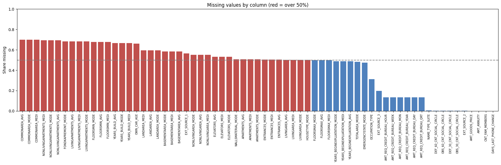
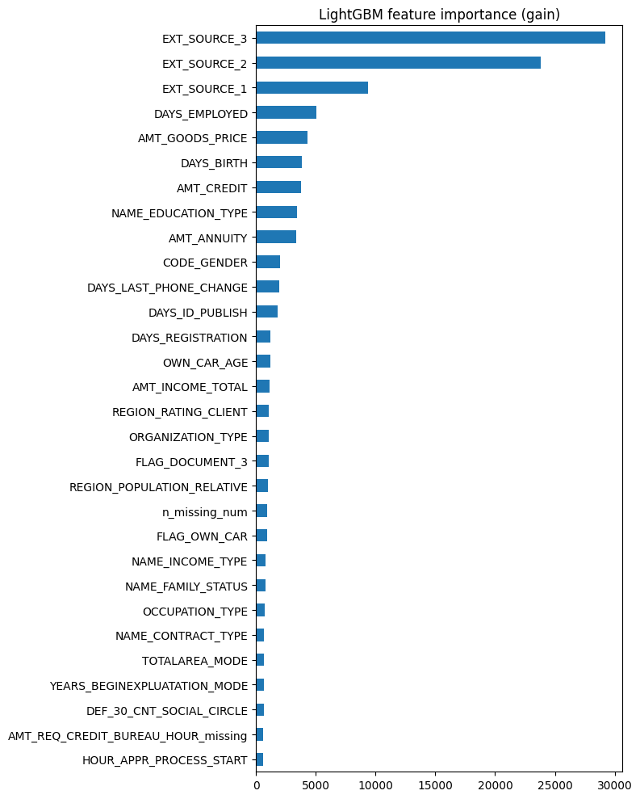
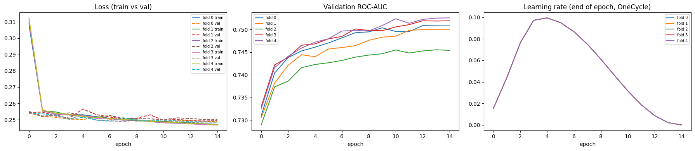
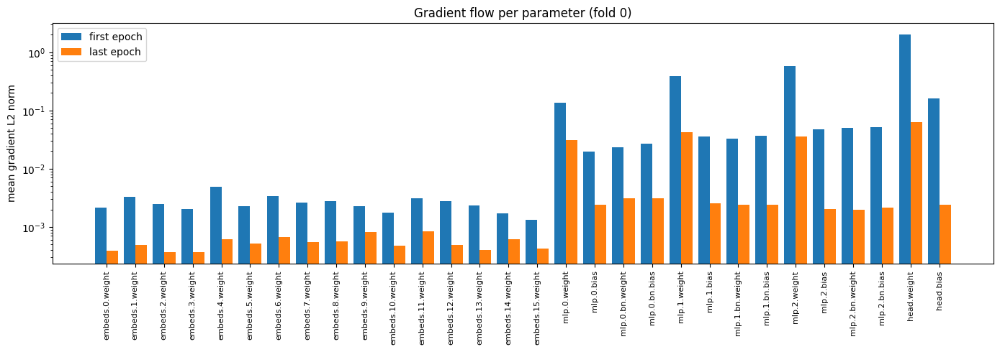

# Final Report HW 1

## Task and Data
Task: Home Credit Default Risk - 307511 rows x 122 columns of tabular data, containing both numerical and categorical values. Task definition: predict each applicant's probability of default, evaluated with ROC-AUC 

### The data contained multiple interesting characteristics and anomalies:

Strong class disbalance, where "defaulted" targets make up only 8% of whole dataset. Though this would be a big deal for PR-AUC or F1 scoring, for the selected metric ROC-AUC it didn't need any fixes.

60+ columns contained missing values, some had more than 50% NaNs - most of these were AVG/MEDI/MODE column groups for the same values, which were highly correlated, so I removed AVG/MEDI columns and filled the NaNs with medians. All the columns that had a statistically significant amount of missing values got a secondary "*_missing" flag column.

`DAYS_EMPLOYED` anomaly - 18% of the dataset contained `365243` in this column - an unrealistic number, ~1000 years of employment. This anomaly correlated with income type - most of the anomaly values were held by pensioners, with a small amount of unemployed. Subsequently, the value 365243 was replaced with NaNs and `DAYS_EMPLOYED` got its own "*_missing" flag column to mark unemployed people.

18 columns filled with mostly one value, predominantly document flags, 13 of which were removed for the lack of usable information. The other 5 remained in place due to minority groups having visually different TARGET mean and relatively high count of said minorities.

## Metric Analysis

Kaggle evaluates submissions with ROC-AUC

### Strengths
- Insensitive to class balance. With an 8:92 ratio it is more informative than accuracy, which would give 92% for majority prediction.
- Doesn't depend on threshold selection.
- Measures ranking quality, which matches the presented tasks (sort applicants by risk and reject the riskiest).

### Weaknesses
- Can look good while precision is poor. With few positives, many false positives don't impact the false-positive rate much, which PR-AUC catches.
- Ignores probability scale. For the same labels, predictions `[0.53, 0.56, 0.57]` and `[0.10, 0.20, 0.70]` would score the same, because only their order matters.

### Edge cases
Undefined if the evaluated subset contains only one class (e.g. poorly distributed validation folds).

### Complementary metrics
PR-AUC: focuses on the minority class and is sensitive to false positives.

LogLoss: measures probability calibration, which ROC-AUC ignores.

Alternative metric: Recall - checking how many of actual defaults were caught by prediction. Pros - false-negative is more expensive for the bank than false-positive, so catching most of the defaults is more important than marking all non-defaults. Cons - needs some limits to also reduce false-positives, like ranking clients by scores and rejecting only the riskiest 10%, and this threshold can also influence preformance. Considering the negative side, best to use "fixed rejection amount recall" with ROC-AUC as complementary to mitigate the risks of using only recall and check the overall quality

### Results on out-of-fold predictions

| Model | ROC-AUC | PR-AUC | LogLoss | Recall 10% |
|---|---|---|---|---|
| Random baseline | 0.500 | 0.081 | - | 0.100 |
| LightGBM | 0.7584 | 0.2411 | 0.2462 | 0.3346 |
| Neural network | 0.7497 | 0.2312 | 0.2491 | 0.3238 |

### Reflection

- ROC-AUC helped with ensembling due to its ranking nature. Because only order matters, the models' probability scales did not need to agree. LightGBM's and NN's predictions could be combined directly into ensemble submission.
- Recall made the scores interpretable: 33.5% of defaulters caught by rejecting 10% of applicants = 3.3× better than random (0.1).
- PR-AUC confirms the weakness of ROC-AUC - 0.758 sounds solid, but 0.24 PR-AUC shows that precision on positive class stays low.

## Preprocessing and Feature Engineering

Preprocessing is split into two stages: Part 1 builds a shared dataset used by both models, Part 3 adds engineered features used only by the neural network.

### Stage 1: shared preprocessing (Part 1)

1. Cleaning
- `DAYS_EMPLOYED`: placeholder `365243` replaced with NaN.
- `AMT_INCOME_TOTAL`: clipped at the train 99.9th percentile.
- `NAME_INCOME_TYPE`: rare categories (Unemployed, Student, Businessman, Maternity leave; 55 rows total) merged into "Other".

2. Column removal (44 columns, 122 -> 78)

| Group | Count | Reason |
|---|---|---|
| `*_AVG`, `*_MEDI` housing statistics | 28 | heavy correlation to `*_MODE` |
| Near-constant cols | 13 | Minority groups too small or no default-rate difference |
| `OBS_30_CNT_SOCIAL_CIRCLE`, `REGION_RATING_CLIENT_W_CITY` | 2 | closely correlated to a kept column |
| `SK_ID_CURR` | 1 | Identifier (kept aside for the submission) |

3. Categorical encoding (16 columns)
Each categorical column is mapped to integer codes, cardinalities and dimensions are then saved in `meta.json` so later notebooks can rebuild the embedding layers.

4. Missing value columns
Of the 61 numeric columns, 33 contain NaNs. Columns with at least 1% missing values in train (25 total) get a `*_missing` flag. Both datasets got a column with amount of missing values per row `n_missing_num`.

5. Scaling
The 61 numeric columns are filled with train medians, then standardized (except binary flags).

Result: processed datasets exported as `train_x_bronze.csv.gz`, `train_y_bronze.csv.gz`, `test_bronze.csv.gz` and `meta.json`.

### Stage 2: engineered features for NN (Part 3)

16 features were computed from the raw application tables (before any modifications from previous step):

| Group | Features |
|---|---|
| Financial ratios (6) | `credit / income`, `annuity / income`, `annuity / credit`, `goods_price / credit`, `income / family_members`, `children / family_members` |
| External score aggregates (6) | mean, std, min, max and product of `EXT_SOURCE_1-3`, number of missing EXT_SOURCE values |
| Time ratios (4) | `days_employed / age`, `days_since_phone_change / age`, `days_since_id_published / age`, `days_since_registration / age` |

### Differences between the models

| | LightGBM | Neural network |
|---|---|---|
| Categoricals | Integer codes used as numeric values | Learned embeddings |
| Scaling | Present but irrelevant for trees | Required |
| Engineered features | Not used | 16 ratio/aggregate features |

## Validation

Strategy: stratified 5-fold CV with set seed to keep the pos/neg ratio identical in all folds. The same folds are reused for LightGBM and the NN, so their OOF predictions are directly comparable and can be stacked. Parameter tuning used 2 of the 5 folds to save time, final models were trained on all 5.

Correlation with the leaderboard: high, but not perfect. Adversarial validation has shown that train and test rows are clearly different (AUC 0.895), but the tests between "test-like" and train rows gave reasons to believe that local validation is reliable for comparing models (yet, expecting lower scores on leaderboards).

Local vs leaderboard:

| Model | Local | Public | Private | Gap (local vs private) |
|---|---|---|---|---|
| LightGBM | 0.7584 | 0.74715 | 0.74489 | -0.013 |
| Neural network | 0.7502 | 0.73972 | 0.73571 | -0.015 |
| Ensembling | 0.7594 | 0.74806 | 0.74534 | -0.014 |

The ranking of models is identical locally and on both leaderboards, and the gap is almost constant, proving local CV as a reliable tool for choosing between models.

## Machine Learning Baseline

`LGBMClassifier` with `n_estimators=2000`, `max_bin=63` and early stopping after 50 rounds without AUC improvement on validation. Tuned by random selection of 6 configurations from parameter pool, evaluated on 2 of the 5 folds to save time.

Winner:

| learning_rate | num_leaves | min_child_samples | colsample_bytree | reg_lambda | CV AUC |
|---|---|---|---|---|---|
| 0.10 | 15 | 50 | 0.5 | 1 | 0.75878 |

(full log: `lgbm_tuning_log.csv`)

All trials scored close to each other, so the model is not very sensitive to these parameters. 

Results:

| Metric | Value |
|---|---|
| Per-fold AUC | 0.7594 / 0.7581 / 0.7534 / 0.7578 / 0.7632 |
| CV AUC | 0.7584 ± 0.0032 |
| PR-AUC | 0.2411 |
| LogLoss | 0.2462 |
| Recall@10% | 0.3346 |
| AUC on test-like 20% | 0.7552 |
| Public / Private LB | 0.74715 / 0.74489 |

Conclusion: the model is adequate as a baseline. Validation is stable across folds, the leaderboard gap matches the one predicted in the Validation section, and rejecting the riskiest 10% of applicants catches a third of all defaulters. It's limited by small tuning and timing budgets, and no feature engineering specific to this model.

## Deep Learning Model

Custom layer: `weight` and `bias` as `nn.Parameter`s, Kaiming-uniform weight initialization, `LayerNorm`, `ReLU` and dropout.

Custom optimizer: SGD with momentum and L2 weight decay, compared with `torch.optim.SGD` with identical settings - identical results.

Architecture: 16 embeddings (64 dims) + 103 numeric features -> 167 -> 3 × CLayer(512) → Linear(1), trained with BCEWithLogitsLoss

### Tuning (4 rounds, random search on 2 folds)

| Round | Learning rate range | Hidden | Best CV AUC |
|---|---|---|---|
| 1 | 0.003-0.01 | 256-512 | 0.7353 |
| 2 | 0.01-0.05 | 256-512 | 0.7428 |
| 3 | 0.05-0.1 | 512-1024 | 0.7501 |
| 4 | 0.05-0.1 | 512-1024 | 0.7504 |

(all logs in `./logs` dir, named `nn_tuning_log_*.csv`)

Final parameters: `lr=0.1, hidden=512, n_layers=3, dropout=0.1, weight_decay=1e-4, batch_size=2048`.

### Results

| Metric | Value |
|---|---|
| Per-fold AUC | 0.7509 / 0.7500 / 0.7455 / 0.7519 / 0.7526 |
| CV AUC | 0.7502 ± 0.0025 |
| PR-AUC | 0.2312 |
| LogLoss | 0.2491 |
| Recall@10% | 0.3238 |
| Public / Private LB | 0.73972 / 0.73571 |

Conclusion: the model is adequate. Validation is stable, the leaderboard gap is the same as for LightGBM, though it's weaker than LightGBM. Its main value is as a second model for the ensemble.

## Ensembling

| Method | OOF AUC |
|---|---|
| LightGBM | 0.75837 |
| NN | 0.74971 |
| Mean of probabilities | 0.75820 |
| Mean of ranks | 0.75829 |
| Weighted rank blend | 0.75938 |
| Logistic regression | 0.75940 |

An equal-weight average is worse than LightGBM alone: the weaker NN pulls it down. 

Result: 0.74806 public / 0.74534 private - the gain is small but present on both leaderboards.

## Final Results

| Model | Local CV | Public | Private | PR-AUC | Recall@10% |
|---|---|---|---|---|---|
| LightGBM | 0.7584 | 0.74715 | 0.74489 | 0.2411 | 0.3346 |
| Neural network | 0.7502 | 0.73972 | 0.73571 | 0.2312 | 0.3238 |
| Stacking | 0.7594 | 0.74806 | 0.74534 | - | - |

Conclusions
- Local CV was reliable for comparisons and predictions of leaderboard rankings
- Gradient boosting is a stronger model on this tabular data
- `EXT_SOURCE_1-3` columns carry most of the signal, both from LightGBM importance and NN's engineered features
- The ensemble gives a small but consistent improvement

## Failed Ideas

What did not work
- Low learning rates for the NN (0.003-0.01): undertrained, 0.70-0.74 AUC.
- Wider or deeper networks: hidden = 1024 or 4 layers gave no gain over 512 × 3 and were miltiple times slower.
- Larger trees in LightGBM: the worst trial, probably overfitted.
- Averaging of the models for ensemble: worse than LightGBM alone.

Limitations
- Used only the main application table, the secondary tables were ignored.
- The engineered features were not given to LightGBM.
- Tuning budgets were small, each evaluated on only 2 folds.

## AI Usage

All links to AI chats provided in [ai_usage.txt](./ai_usage.txt) file.